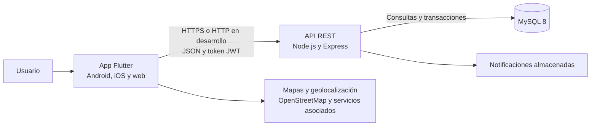

# Documentación del proyecto UniRaite

## Avance del proyecto al 60 por ciento

**Tipo de documento:** documentación técnica y funcional parcial  
**Fecha del corte:** 4 de noviembre de 2026  
**Equipo:** JAH Devs (Aron, Hugo y José de Jesús)

## Resumen

UniRaite es una aplicación de viajes compartidos para la comunidad universitaria. Permite publicar recorridos, buscar viajes, solicitar asientos y coordinar la comunicación entre conductores y pasajeros. El proyecto cuenta con una aplicación Flutter, una API REST en Node.js y una base de datos MySQL. En el código también están presentes las funciones de administración de cuentas, notificaciones, mapas y consulta de ubicación durante un viaje.

Este corte presenta el proyecto con un **avance global reportado del 60 %**. La funcionalidad principal está representada en el código y existen instrucciones y scripts de despliegue. Quedan por completar y comprobar pruebas integrales, validación en dispositivos y servidores, y tareas de preparación para una publicación estable. El porcentaje corresponde al avance indicado para este corte; el repositorio no incluye una matriz ponderada de actividades para calcularlo automáticamente.

**Avance presentado:** `██████░░░░ 60 %`

## 1. Propósito y alcance

El propósito de UniRaite es facilitar la coordinación de viajes entre integrantes de una comunidad universitaria. Una misma cuenta puede ofrecer viajes y reservar asientos; el rol de conductor o pasajero depende de la acción que realiza en cada viaje. La base de datos distingue además a las cuentas con permisos de administración.

El alcance funcional visible en el repositorio comprende:

- Registro, inicio de sesión y perfil de usuario.
- Registro de vehículos para publicar viajes.
- Búsqueda de viajes por origen, destino y fecha.
- Solicitud, aceptación, rechazo o cancelación de asientos.
- Administración de rutas guardadas y notificaciones.
- Calificaciones después de finalizar un viaje.
- Revisión y suspensión de cuentas por administradores.
- Mapas de ruta y actualización de la ubicación del conductor durante un viaje.

La aplicación se desarrolla principalmente para Android y iOS. También hay configuración y scripts para publicar una versión web tipo PWA.

## 2. Arquitectura general

La aplicación móvil no se conecta directamente a MySQL. Envía solicitudes HTTP a la API, y el backend valida cada operación y consulta la base de datos.



### Componentes

| Componente | Tecnología | Responsabilidad |
|---|---|---|
| Aplicación | Flutter y Dart | Interfaz, navegación, sesión, solicitudes a la API, mapas y alertas locales. |
| Backend | Node.js, Express y `mysql2` | Autenticación, autorización, reglas de negocio y acceso a datos. |
| Base de datos | MySQL 8 o posterior | Usuarios, vehículos, viajes, solicitudes, reseñas, rutas, notificaciones y ubicación. |
| Publicación | Nginx y `systemd` en los scripts de servidor | Servir la web y el APK, y dirigir las solicitudes de la API al backend. |

## 3. Funciones principales

### Aplicación móvil

Las pantallas implementadas incluyen acceso y registro, búsqueda, publicación de viajes, viajes como conductor, reservas como pasajero, detalle del viaje, perfil, vehículos, rutas guardadas, notificaciones y administración. La app utiliza `Provider` para compartir el estado de sesión y un cliente centralizado para comunicarse con la API.

Los mapas se apoyan en Flutter Map y servicios relacionados con OpenStreetMap para localizar lugares y trazar rutas. Durante un viaje en curso, la app puede enviar y consultar la ubicación del conductor mediante la API, sujeto a permisos de ubicación y conectividad.

### Backend y API

Las rutas principales están agrupadas de esta manera:

| Grupo | Ejemplos de rutas | Función |
|---|---|---|
| Estado y configuración | `GET /api/salud`, `GET /api/config` | Comprobar conexión con la base y consultar dominios institucionales. |
| Autenticación | `POST /api/auth/registro`, `POST /api/auth/login` | Crear cuenta e iniciar sesión. |
| Perfil | `GET/PATCH /api/usuarios/me`, `PUT/DELETE /api/usuarios/me/foto` | Consultar y modificar el perfil. |
| Vehículos | `GET/POST /api/vehiculos`, `DELETE /api/vehiculos/:id` | Gestionar vehículos propios. |
| Viajes | `GET/POST /api/viajes`, `GET /api/viajes/:id`, `PATCH /api/viajes/:id/estado` | Buscar, publicar, consultar y cambiar el estado de viajes. |
| Ubicación | `PUT/GET /api/viajes/:id/ubicacion` | Actualizar y consultar la ubicación del conductor. |
| Solicitudes | `POST /api/viajes/:id/solicitudes`, `PATCH /api/solicitudes/:id` | Solicitar, responder o cancelar una reserva. |
| Rutas y avisos | `/api/rutas`, `/api/notificaciones` | Guardar rutas y consultar o marcar notificaciones. |
| Reseñas | `POST /api/resenas` | Registrar calificaciones de participantes. |
| Administración | `/api/admin/usuarios`, `/api/admin/estadisticas` | Consultar estadísticas y gestionar estados de cuenta. |

Las rutas privadas requieren un token JWT. Las contraseñas se almacenan mediante hash con bcrypt. El middleware vuelve a consultar el estado de la cuenta y valida permisos de administrador para las rutas administrativas.

### Notificaciones

El backend guarda los avisos en MySQL. La aplicación consulta periódicamente la API y puede mostrarlos en la interfaz o como notificaciones locales, según los permisos del dispositivo. El envío remoto mediante Firebase Cloud Messaging no aparece integrado; es una mejora pendiente si se requiere entrega push confiable con la app cerrada.

## 4. Modelo de datos

El esquema incluye estas entidades principales:

| Tabla | Información que representa |
|---|---|
| `Usuarios` | Datos de cuenta, estado, permisos, foto y calificación promedio. |
| `Vehiculos` | Vehículos asociados a sus propietarios y capacidad. |
| `Viajes` | Conductor, vehículo, origen, destino, salida, asientos y estado. |
| `Solicitudes_Asiento` | Relación entre un viaje y sus pasajeros solicitantes. |
| `Rutas_Guardadas` | Rutas que un usuario desea vigilar. |
| `Notificaciones` | Avisos asociados a usuarios y, cuando aplica, a viajes. |
| `Resenas` | Calificaciones y comentarios entre participantes. |
| `Ubicacion_Viaje` | Última posición reportada para un viaje en curso. |

Un usuario puede registrar varios vehículos y publicar varios viajes. Cada viaje pertenece a un conductor y a un vehículo; los pasajeros se relacionan con el viaje mediante solicitudes. Un viaje puede tener reseñas y, durante su ejecución, una ubicación vigente.

El esquema contiene claves foráneas, índices, restricciones únicas y triggers. Entre las reglas que aplica están la capacidad de vehículo de 1 a 8 pasajeros, la prevención de reservas del propio conductor y el ajuste de asientos al aceptar o liberar una solicitud. La aceptación se protege con una transacción y bloqueo de la fila del viaje para reducir el riesgo de sobreventa.

Los estados definidos para un viaje son `Programado`, `En Curso`, `Finalizado` y `Cancelado`. Las solicitudes pueden estar `Pendiente`, `Aceptada`, `Rechazada` o `Cancelada`.

## 5. Flujo de uso esperado

1. La persona crea una cuenta e inicia sesión.
2. Si su correo pertenece a un dominio institucional configurado, la cuenta se activa automáticamente; si no, queda pendiente de validación administrativa.
3. Para ofrecer un viaje, registra un vehículo y publica origen, destino y horario.
4. Los pasajeros buscan viajes y envían solicitudes de asiento.
5. El conductor acepta o rechaza las solicitudes. Al aceptar, la disponibilidad se actualiza.
6. Durante el viaje, el conductor puede compartir su ubicación y cambiar el estado del recorrido.
7. Después de finalizar, los participantes pueden calificarse.

## 6. Configuración y ejecución

Los archivos del repositorio incluyen un ejemplo de configuración para el backend en `backend/.env.example`. Antes de ejecutar, se deben ajustar la conexión MySQL, un secreto JWT propio, los dominios institucionales y las credenciales iniciales de administración. El archivo `.env` contiene valores locales y no debe publicarse.

### Base de datos

Se requiere MySQL 8 o posterior. Para una instalación nueva, el esquema está en `database/schema.sql`. **Este archivo elimina y vuelve a crear la base `uniraite`**, por lo que no debe ejecutarse sobre una base con datos que se quieran conservar. Para instalaciones existentes, se deben revisar las migraciones incluidas y aplicarlas según la versión del esquema.

### Backend

Desde la carpeta `backend`:

```powershell
npm install
npm run seed
npm start
```

La API usa el puerto 3000 de manera predeterminada. La ruta `GET /api/salud` informa si puede conectarse a la base de datos. En un entorno con datos o usuarios reales, las credenciales deben definirse fuera del repositorio y protegerse adecuadamente.

### Aplicación

Desde la carpeta `app`:

```powershell
flutter pub get
flutter run --dart-define=API_URL=http://localhost:3000/api
```

En un teléfono físico, `API_URL` debe apuntar a una dirección alcanzable desde ese dispositivo, como la IP local del equipo de desarrollo. Para compilar APK o web, el proyecto y los scripts de despliegue contienen instrucciones adicionales.

## 7. Estado del avance

| Área | Estado en este corte |
|---|---|
| Arquitectura móvil, API y base de datos | Definida y reflejada en la estructura del repositorio. |
| Operaciones centrales de viaje y reservas | Implementadas en pantallas, rutas de API y reglas de base de datos. |
| Perfiles, vehículos, administración y reseñas | Hay código de interfaz y backend para las funciones principales. |
| Mapas y ubicación del viaje | Hay componentes móviles, rutas de API y tabla de ubicación. Requieren validación de permisos, conectividad y precisión en dispositivos. |
| Notificaciones | Hay persistencia en servidor y consulta desde la aplicación. La integración FCM no está incluida. |
| Despliegue | Hay scripts para servidor Ubuntu, Nginx y `systemd`; falta documentar evidencia de una publicación y prueba de extremo a extremo. |
| Pruebas y liberación | Requieren completar pruebas integrales, revisión multiplataforma y preparación de una versión estable. |

El repositorio no muestra un script de pruebas automatizadas para el backend en `backend/package.json`. Por ello, la presencia de funciones en el código no se toma como evidencia de que todos los flujos ya hayan sido probados en un entorno real.

## 8. Trabajo pendiente para completar el proyecto

Las siguientes actividades forman el tramo restante de este avance:

1. Definir y ejecutar pruebas de extremo a extremo: registro, validación de cuenta, publicación, solicitud, aceptación, cancelación, finalización y calificación.
2. Probar la aplicación en dispositivos Android y iOS, incluyendo permisos de ubicación, mapas, notificaciones y recuperación de conexión.
3. Validar la instalación y actualización en un servidor de prueba, con dominio, HTTPS, Nginx, servicio de backend y configuración segura.
4. Decidir si se requiere Firebase Cloud Messaging e integrarlo para los casos de notificación con la app cerrada.
5. Documentar respuestas y errores de la API, procedimientos de respaldo y restauración, y manejo operativo de incidentes.
6. Corregir los hallazgos de QA y preparar el paquete final de distribución.

## Conclusión

UniRaite ya cuenta con una base funcional que conecta aplicación, API y persistencia de datos, e incluye los flujos esenciales para compartir viajes universitarios. Este documento deja asentado el estado como **avance parcial del 60 %**. La siguiente etapa debe concentrarse en comprobar los flujos completos, validar la ejecución en dispositivos y servidor, y cerrar los pendientes de notificaciones y preparación de la versión estable.

## Archivos de referencia

- `README.md`: visión general y pasos básicos de ejecución.
- `app/pubspec.yaml`: dependencias y configuración de Flutter.
- `app/lib/screens/`: pantallas de la aplicación.
- `app/lib/api/api_client.dart`: comunicación entre la aplicación y la API.
- `backend/src/server.js`: inicialización y montaje de rutas del backend.
- `backend/src/routes/`: endpoints de la API.
- `database/schema.sql`: esquema MySQL y reglas de integridad.
- `deploy/`: scripts y configuración de publicación.
